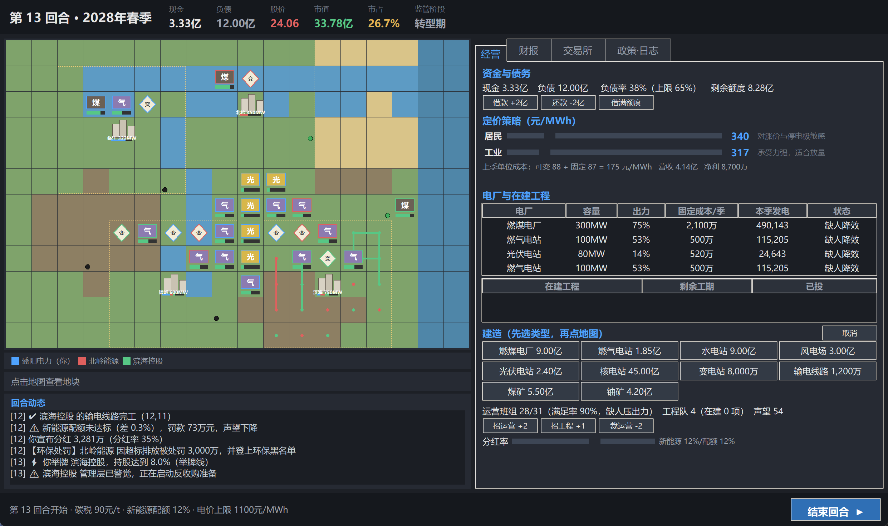
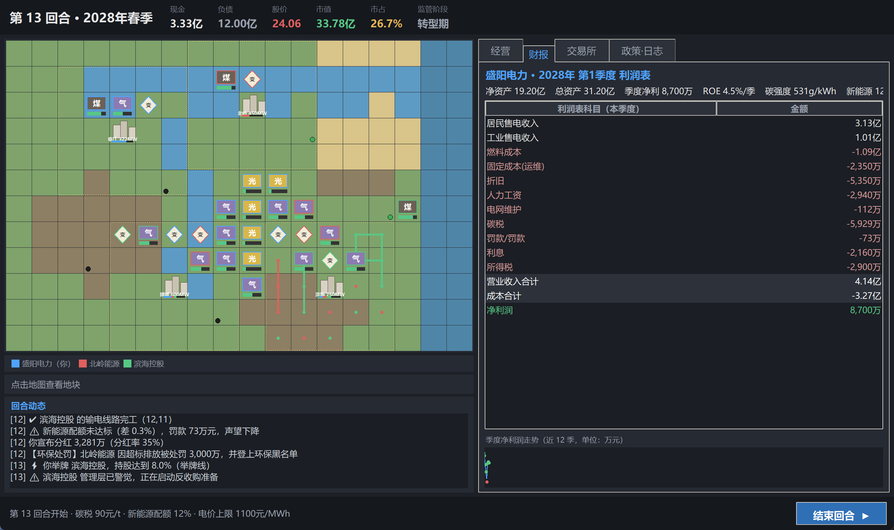
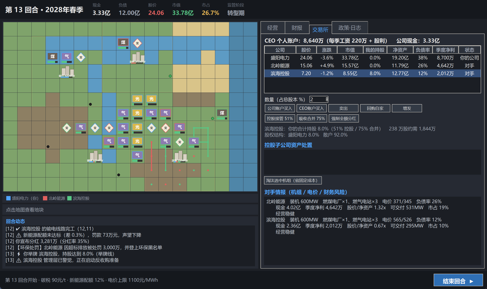

# 电力公司 · Power Company

> 2D 回合制「电力经营 + 证券并购博弈」模拟游戏 —— 经营电网决定财报，财报决定股价；
> 用电价战术打压对手财报、砸低对手股价，在股市收购对手壮大自己，同时提防 AI 用同样手段吞并你。

纯 Python + tkinter，**零第三方依赖**，双击即玩。



| 财报 | 交易所 |
|---|---|
|  |  |

---

## 快速开始

```bash
python main.py                 # 启动游戏
python main.py --seed 2026     # 指定地图/随机种子（换一张地形与矿脉分布）
```

- 运行环境：Python 3.10+（开发验证于 3.12），Windows / macOS / Linux 均可（需要 tkinter）。
- 界面支持高 DPI：启动时声明 DPI 感知，所有像素尺寸按实际 DPI 缩放。

### 打包成 exe（Windows）

```bat
build.bat             :: 生成 dist\电力公司\  （推荐：启动快、杀软误报少）
build.bat onefile     :: 生成 dist\电力公司.exe（单文件，首次启动要解压 1~2 秒）
```

- 首次运行会自动抓取 PyInstaller 到 `build_tools\`（走 PyPI JSON API，不污染系统 Python），
  并生成 `assets\app.ico`；之后直接复用。
- **Python 自动探测**：脚本会跳过 Windows 应用商店的 `WindowsApps\python.exe` 占位程序，
  依次尝试 PATH 里的 python / py、`%LOCALAPPDATA%\Programs\Python\Python3*`、`C:\Python3*`，
  并校验 tkinter 是否可用。都不行时用环境变量指定：
  `set PYTHON=D:\Python312\python.exe && build.bat`
- 产物自带自检：`dist\电力公司\电力公司.exe --selftest`，
  打印 tkinter / 引擎 / 界面三项检查结果，返回码 0 即打包完整。
- 存档位置：exe 模式下优先 `%APPDATA%\PowerCompany\`，不可写时自动回落到 exe 同目录 `saves\`，
  再不行落系统临时目录（便携版 / U 盘 / 受限权限都能跑）。
- 分发时把 `dist\电力公司` 整个文件夹压成 zip 即可。

其他入口（都是开发自用工具，游戏本体不需要它们）：

```bash
python main.py --selftest      # 无窗口自检（打包后验收用）
python tools/sim.py 48         # 无头模拟 48 回合，看数值是否健康（开发用）
python tools/sim.py 12 noisy   # 每回合打印完整利润表
python tools/balance.py 6      # 机器人跑 6 局，统计胜率与达成回合
python -m unittest discover -s tests -v   # 29 个引擎单元测试
python tools/ui_smoke.py       # 界面交互冒烟测试（建造/买股/控股/合并）
python tools/demo_shot.py 12   # 自动截图到 docs/screenshots/（需 Pillow）
```

---

## 一局游戏在玩什么

| 阶段 | 你做的事 | 对应界面 |
|---|---|---|
| 观察 | 需求峰谷、煤价/铀价、政策台阶、对手财报与股价 | 政策·日志 / 交易所 |
| 基建 | 建电厂、变电站、输电线、煤矿铀矿；招人/裁员；借款 | 经营（点地图建造） |
| 定价 | 居民与工业分开定价：盈利定价 or 掠夺定价 | 经营（滑杆） |
| 结算 | 点【结束回合】→ 供需 → 调度 → 成本 → 财报 | 财报 |
| 股市 | 报告落地 → 全市场股价刷新 → 买股 / 回购 / 控股 / 合并 | 交易所 |
| 事件 | 风暴、罢工、煤价暴涨、政策收紧、核电核准 | 回合动态 |

核心循环只有一句：**经营赚的钱 → 决定财报 → 决定股价 → 决定你能买下谁、谁又能买下你。**

---

## 关键机制（必须懂的四条）

1. **固定成本照扣**
   每座电厂每季度都要付折旧 + 运维，哪怕一度电都不发。产能过剩会直接吞掉利润。

2. **电网不是摆设**
   电厂必须和「城市 2 格内的变电站」通过相邻的线路连成一片（地图上黄色虚线圈 = 供电服务圈）。
   城市接口容量 = 圈内变电站 180MW + 线路 120MW 之和，线损随距离上升。
   送不出去的电 = 没有收入，但你依然付燃料和固定成本。

3. **客户看两件事：电价 + 可靠性**
   份额按 `(市场均价 / 你的价)^弹性 × 口碑` 分配，但每家拿到的份额不超过它的可交付容量。
   想抢份额必须先建产能；只降价不建厂没有意义。掠夺定价持续 3 回合并超过 55% 份额 → 反垄断处罚。

4. **财报决定股价，股价决定生死**
   股价 = 滚动四季度 EPS × PE + 净资产锚定；亏损会把股价打到净资产以下。
   5% 举牌 / 20% 董事席位 / 51% 控股（可强制分红抽血、淘汰其机组）/ 75% 吸收合并（资产债务人力全并入）。
   反过来，你负债过高、连续亏损时，AI 会低价抢客户 + 悄悄吸你的股票，持股过 51% 你就出局。

---

## 胜负

- 🏆 **霸权结局**：全市场供电份额 ≥ 50% 且总市值第一
- 🌿 **绿色转型结局**：新能源占比 ≥ 55%、碳强度 ≤ 180g/kWh、碳税进入最高档
- 💀 **失败**：资不抵债破产，或被 AI 持股超过 51%（沦为子公司）

---

## 目录结构

```
main.py                  启动入口
pwer/
  constants.py           全部可调数值（单位约定：万元 / MW / MWh / 元每 MWh）
  world.py               地形、地块、矿产资源、建造权限与造价
  company.py             公司、电厂、矿、在建工程、利润表
  grid.py                电网连通、城市可交付容量、线损
  dispatch.py            需求分流、机组调度、燃料与限电
  valuation.py           股价模型（EPS × PE + 净资产锚定）
  ma.py                  股权、回购、增发、控股、吸收合并
  policy.py              碳税 / 新能源配额 / 电价上限 / 反垄断
  events.py              15 种随机事件
  ai.py                  对手 AI（建厂、报价、抄底、反收购）
  engine.py              回合编排、财务结算、胜负判定
  ui/
    app.py               主窗口：顶栏 / 地图 / 四个页签 / 底栏
    mapview.py           2D 格子地图绘制与点击
    scale.py             DPI 缩放
build.bat                打包成 Windows exe（自动探测 Python + 自检）
tests/test_engine.py     29 个不变量测试
tools/                   开发工具：无头模拟、胜率验证、界面冒烟、图标与打包辅助
docs/screenshots/        截图（仅 README 展示用，可整目录删除）
assets/app.ico           应用图标
DESIGN.md                设计文档 → 实现映射、完整数值表与公式
```

---

## 操作提示

- 选建筑类型 → 地图上绿色地块可建 → 点击确认；再点【取消】退出建造模式。
- 鼠标悬停地块看造价与不可建原因；点击城市看各公司份额。
- 交易所页：先选中公司 → 填「数量（占总股本 %）」→ 公司账户 / CEO 账户买入。
- 51% 后可【控股接管】、强制全额分红、淘汰其落后机组；75% 后可【吸收合并】。
- `Ctrl+Enter` 结束回合；菜单可保存/读取进度（`saves/slot1.pkl`）。

---

## 数值一览（摘录，完整表见 DESIGN.md）

| 电源 | 容量 | 造价 | 固定成本/季 | 可变成本 | 碳排 | 工期 | 容量因子 |
|---|---|---|---|---|---|---|---|
| 燃煤 | 300MW | 300万/MW | 7.0万/MW | 224元/MWh | 0.85t/MWh | 2 季 | 78% |
| 燃气 | 100MW | 185万/MW | 5.0万/MW | 380元/MWh | 0.40t/MWh | 1 季 | 55% |
| 水电 | 150MW | 600万/MW | 6.5万/MW | 10元/MWh | 0 | 3 季 | 50%×来水 |
| 风电 | 100MW | 300万/MW | 6.5万/MW | 2元/MWh | 0 | 2 季 | 30%×风资源 |
| 光伏 | 80MW | 300万/MW | 6.5万/MW | 1元/MWh | 0 | 1 季 | 19%×光资源 |
| 核电 | 600MW | 750万/MW | 12万/MW | 60元/MWh | 0.02t/MWh | 5 季 | 90% |

政策台阶：第 5 / 9 / 14 / 20 / 27 回合依次提高碳税（40→320 元/t）与新能源配额（5%→42%）。
